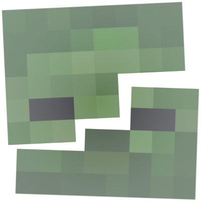

# Coup de Grâce

Minecraft 1.20.1 Forge mod that adds a GTA-style adrenaline rush visual effect after killing any living entity.

## 🔌 Dependencies

* **[Cloth Config API (Forge)](https://www.curseforge.com/minecraft/mc-mods/cloth-config)** (Required for the in-game configuration menu)

---

## ⚡ Features

* **Adrenaline Rush Effect:** Automatically triggers a cinematic visual vignette and gameplay shift upon felling any living entity.
* **Lightweight & Shader-Friendly:** Built using custom overlay rendering rather than heavy post-processing shaders, ensuring full compatibility with OptiFine, Oculus, and popular shaderpacks.
* **Fully Configurable:** Easily adjust effect duration and intensity via an in-game menu.

---

## ⚙️ Configuration

You can customize the adrenaline rush settings in-game via **Mods > Coup de Grâce > Config** or by editing `config/coupdegrace-client.toml` directly.

---

## 🐛 Issues & Feedback

Found a bug or have a feature request? Feel free to open an issue on the [Issue Tracker](https://github.com/Caferino/CoupDeGrace/issues).

---

## 📄 License

This project is licensed under the [GNU General Public License v3.0](LICENSE).